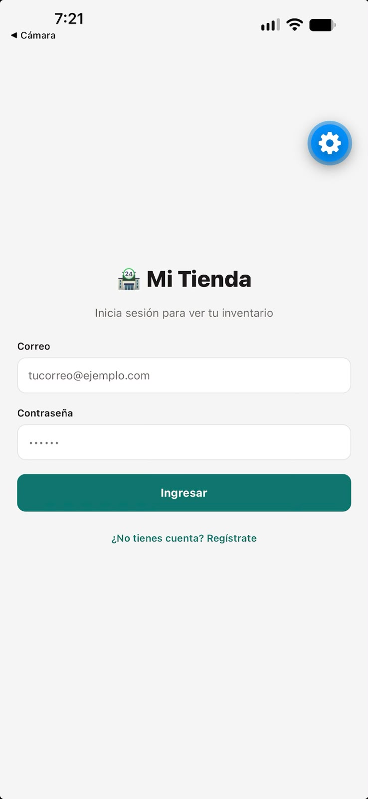
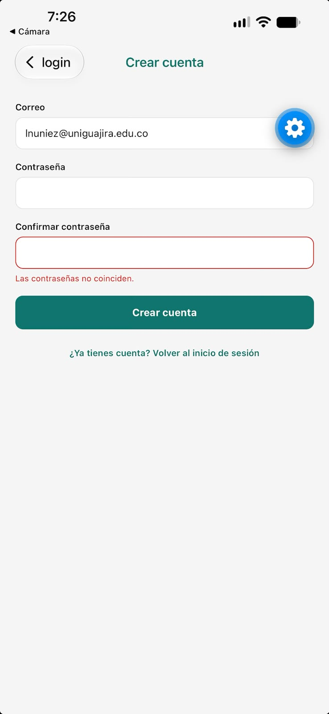
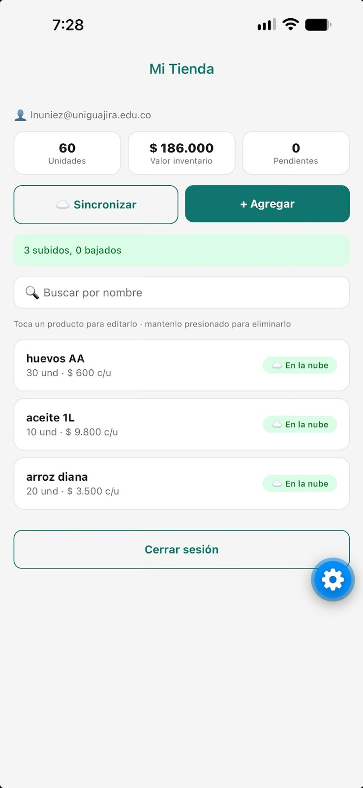
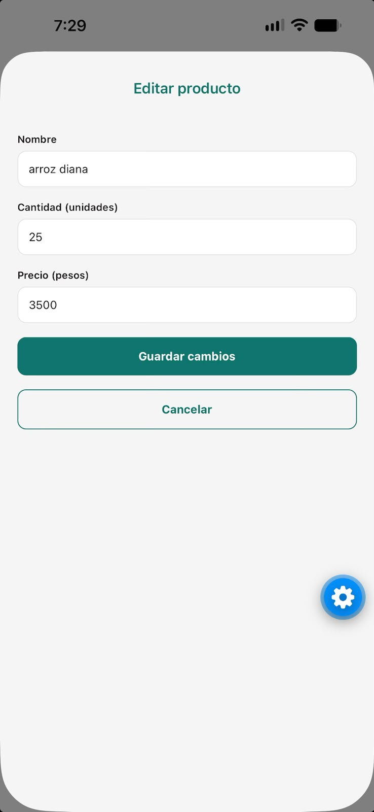
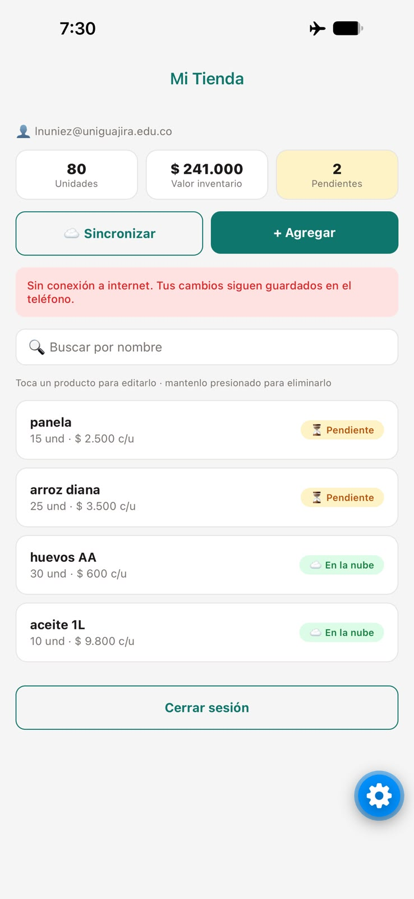
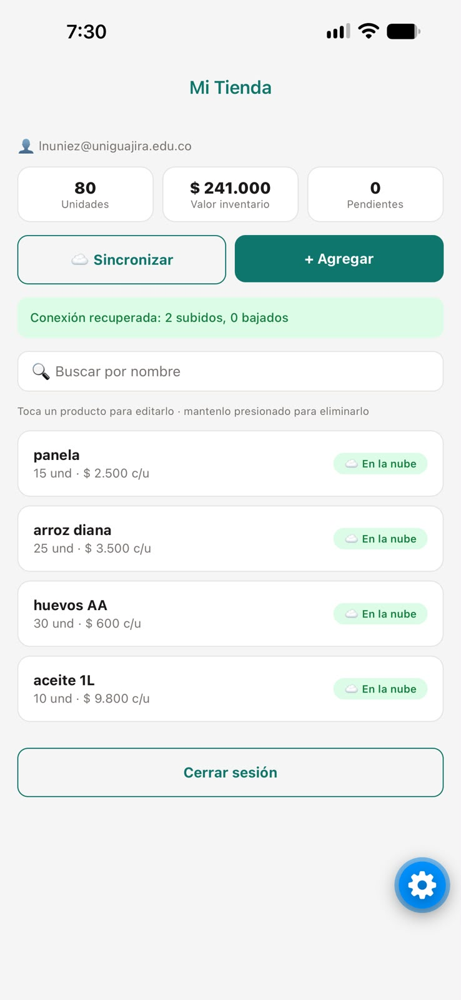
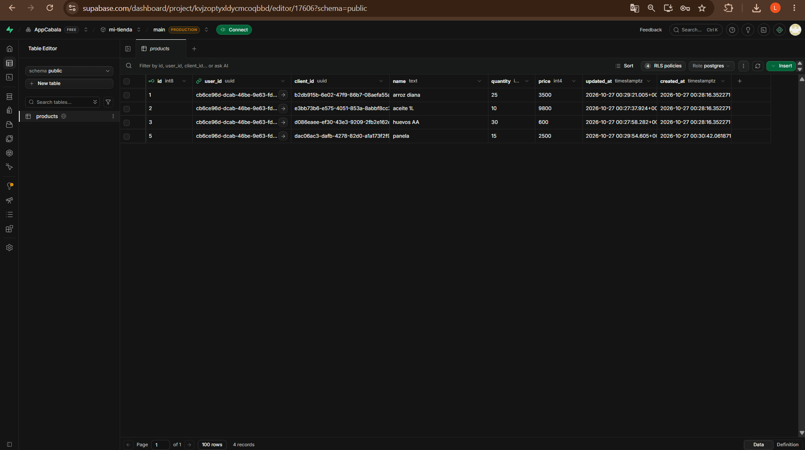

# Mi Tienda 🏪 — Parcial

App de inventario para la tienda de Doña Rosa: funciona **con o sin internet** (SQLite es la fuente de
verdad) y guarda una copia en la nube (Supabase) al sincronizar.

**Estudiante:** _NOMBRE COMPLETO_ · **Código:** _CÓDIGO_

Expo SDK 57 · TypeScript · Expo Router · SQLite + Drizzle ORM · Supabase (Auth + Postgres con RLS)

## Cómo ejecutar

1. **Supabase**
   - Ejecuta [`supabase/schema.sql`](supabase/schema.sql) en el **SQL Editor** (tabla `products` + RLS).
   - En **Authentication → Sign In / Providers → Email** desactiva **Confirm email**.
2. **Variables de entorno**: copia `.env.example` como `.env` y pon la URL y la **publishable key**
   de tu proyecto (Project Settings → API Keys). El `.env` no se sube al repositorio.
   ```
   EXPO_PUBLIC_SUPABASE_URL=https://TU-PROYECTO.supabase.co
   EXPO_PUBLIC_SUPABASE_PUBLISHABLE_KEY=sb_publishable_...
   ```
3. **Instalar y ejecutar**
   ```bash
   npm install
   npx expo start
   ```
   Escanea el QR con Expo Go.

Si cambias `db/schema.ts`, genera una migración nueva con `npx drizzle-kit generate`
(se aplica sola al abrir la app con `useMigrations`).

## Capturas

| | |
| :---: | :---: |
|  |  |
| 01 · Inicio de sesión | 02 · Registro con validación |
|  |  |
| 03 · Principal con totales e indicadores | 04 · Editando un producto |
|  |  |
| 05 · Producto creado en modo avión (pendiente) | 06 · Después de sincronizar |



07 · Tabla `products` en el panel de Supabase

## Estructura

```
app/_layout.tsx          → migraciones + AuthProvider + Stack.Protected
app/login.tsx            → inicio de sesión
app/registro.tsx         → registro con validaciones
app/index.tsx            → inventario: lista, totales, pendientes, Sincronizar, Agregar, Cerrar sesión
app/producto.tsx         → crear / editar (si recibe id)
context/AuthContext.tsx  → signUp, signInWithPassword, signOut, sesión
lib/supabase.ts          → cliente de Supabase (solo publishable key)
lib/secureStorage.ts     → adaptador de SecureStore por fragmentos para la sesión
db/schema.ts             → tabla products (Drizzle)
db/client.ts             → SQLite con enableChangeListener
db/repositories/products.ts → todo el acceso a SQLite (las pantallas no importan Drizzle)
hooks/useProducts.ts     → useLiveQuery + totales
hooks/useSync.ts         → estado del botón Sincronizar + sincronización automática
services/sync.ts         → syncProducts(userId): bajar y luego subir
drizzle/                 → migración generada por drizzle-kit
supabase/schema.sql      → SQL de la tabla en la nube
```

## Cómo funciona

- **Autenticación:** Supabase Auth con correo y contraseña. La sesión se guarda en **SecureStore**
  (no AsyncStorage) mediante un adaptador que la parte en fragmentos, porque SecureStore limita cada
  valor a ~2 KB. `Stack.Protected` deja ver solo Login/Registro sin sesión y solo Principal/Formulario con sesión.
- **Base local:** cada creación o edición escribe `updatedAt: new Date()`. Un producto está
  **pendiente** si `syncedAt` está vacío o es anterior a `updatedAt`. La lista usa `useLiveQuery`,
  así que se actualiza sola.
- **Sincronización** (`services/sync.ts`):
  1. **Bajar:** trae los productos del usuario y agrega en SQLite los que no existen (por `client_id`),
     marcados como sincronizados.
  2. **Subir:** envía los pendientes con `upsert(..., { onConflict: 'client_id' })` —por eso no
     duplica filas al repetir— y les pone `syncedAt` = el `updatedAt` que se subió.

## Qué quedó funcionando

- [x] Login, registro con validaciones, cierre de sesión, rutas protegidas y sesión que sobrevive al cerrar la app.
- [x] CRUD en SQLite con Drizzle (migración + `useMigrations`), lista reactiva y totales; funciona en modo avión.
- [x] Confirmación al eliminar (mantener presionado).
- [x] Indicador por producto (☁️ En la nube / ⏳ Pendiente) y contador de pendientes.
- [x] Botón Sincronizar con mensaje de resultado ("2 subidos, 1 bajado") o de error sin conexión.

**Puntos extra implementados**
- [x] Regla de conflicto "gana el último cambio" al bajar productos que ya existen.
- [x] Sincronización automática al recuperar la conexión (NetInfo).
- [x] Búsqueda por nombre en la pantalla principal.

**Limitaciones / fuera de alcance**
- Los borrados no se sincronizan: un producto eliminado en el teléfono sigue en la nube y vuelve a
  bajar en la próxima sincronización.
- La base local no separa productos por usuario: está pensada para un solo usuario por teléfono.
